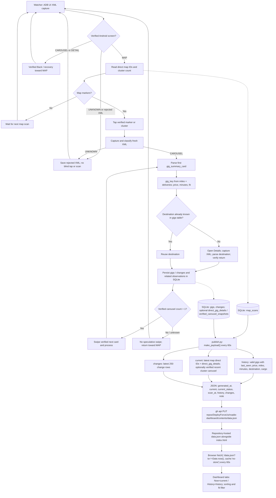

# Roadie Watcher → SQLite → GitHub Publisher → Web dashboard

Source-verified architecture (2026-10-11). Sources: `publish.py`, `index.html` on `main`; Watcher single-card work remains on `fix/single-marker-carousel-cooldown`.

## Exact Publisher contract verified in source

- `publish.py` uses `DB = ~/Downloads/roadie_gigs.sqlite3`, opens SQLite `mode=ro`, and runs `make_payload()` then `publish()` every `INTERVAL = 60` seconds.
- `history` comes from `gigs` (valid numeric price, miles, minutes), sorted by `last_seen`; `changes` reads the newest 250 entries.
- `current` starts with the latest `map_scans.direct_ids_json`, matched against `direct_gig_details.details_json`. Missing details yield `partial_details`; clusters yield `partial_clusters`; complete direct-only maps yield `map_direct_only`.
- A `verified_carousel_snapshots` record can replace `current` only if it is complete, unique, anchored to a preceding scan with `cluster_count == 1`, within a 120-second scan/carousel interval and 180 seconds of now, and within 120 seconds of the latest map scan. Then `current_status='verified_carousel'`.
- `publish()` serializes the payload and runs GitHub CLI `gh api --method PUT repos/DeployForceUs/roadie-dashboard/contents/data.json` using base64 JSON and the previous blob SHA. **No Flask/FastAPI/local HTTP server.**
- `index.html` fetches `./data.json?ts=...` with `cache:'no-store'` immediately and every 60 seconds. It renders `current` for **Now** and `history` for **History**; if fetch fails, it shows demo data.
- GitHub hosting/deployment details (e.g. GitHub Pages URL) are not established by these files alone.

## Current Watcher caveats

- A real single card can have `gig_card_pager` and `gig_summary_card` but no `position_in_stack`; patched parser synthesizes `1/1` solely for parsing, not proof of carousel completeness.
- On 2026-10-11 after Back from CAROUSEL, Roadie showed an empty map without Refresh; watcher rejected UNKNOWN until manual UI interaction. Not fixed.
- Single-card live end-to-end processing, database writes and resulting `current` payload are not yet confirmed.
- **Integration risk:** `current` for direct markers depends on `direct_gig_details` keyed by map gig ID, whereas `gigs` uses `gig_key` like `76_11`. The patch must be checked for maintaining both records. Do not assume a parsed single summary automatically appears in Now.

See [WATCHER_STATE.md](WATCHER_STATE.md) and [CHANGELOG.md](../CHANGELOG.md).

## Product requirement — canonical live Now view (operator clarification, 2026-10-11)

**Required behavior (not current implementation):** The map circle/marker ID is an internal navigation handle only. The **Now** tab must display the actual gig money and details extracted from all cards in the **latest completed verified pass**, regardless of marker IDs. A completed pass atomically replaces the previous live list, including when zero gigs are present. An incomplete/UNKNOWN pass must never silently overwrite the latest completed pass or masquerade as fresh. The dashboard should clearly expose pass timestamp and validity/freshness. Historical data is independent of current availability.

**Implementation mismatch confirmed in `publish.py`:** Current `make_payload()` constructs `current` from latest `map_scans.direct_ids_json` joined to `direct_gig_details` by circle ID, with a special recent verified-carousel override. This is legacy behavior and does **not** meet the stated product requirement. Do not describe it as the desired architecture. A future coordinated Watcher/SQLite/Publisher change should persist a verified, complete pass snapshot of actual gigs and make Publisher read that snapshot. Do not change running Publisher or Watcher without operator approval.
