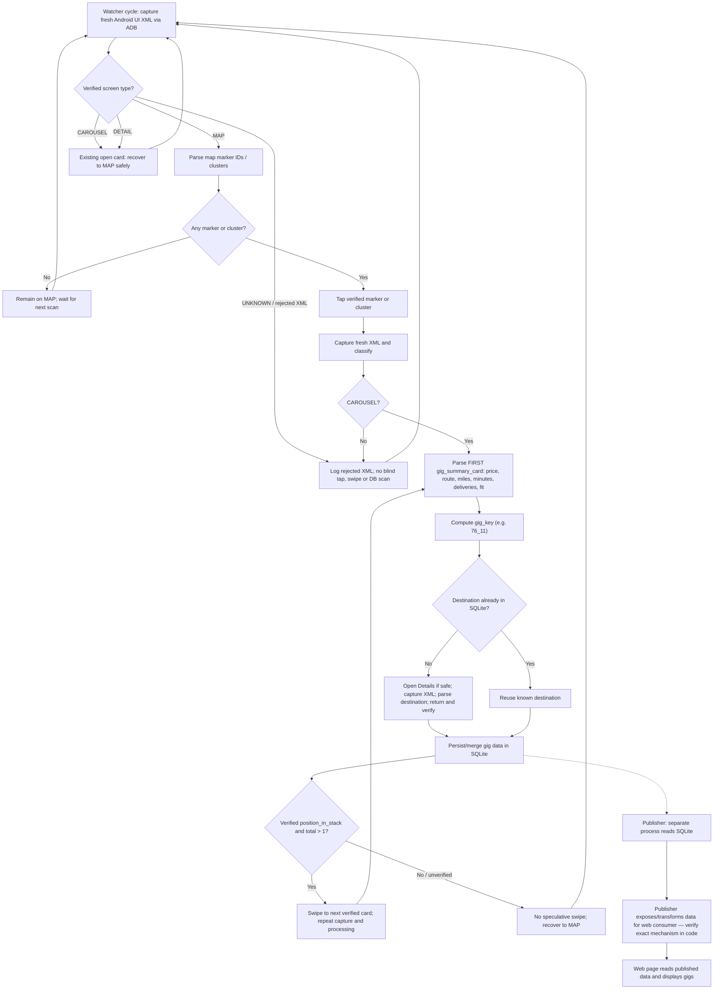

# Roadie Watcher → SQLite → Publisher → Web UI

> **Status:** conceptual architecture diagram, 2026-10-11. Some publisher HTTP endpoints and precise SQL names in the originally rendered illustration were *illustrative*, not verified against source code. Do not treat them as implementation contracts.

The diagram below is version-controlled Mermaid. The separately generated PNG infographic was not committed as a binary image; Mermaid renders directly on GitHub.

## Important evidence and limitations

- Real single gig XML contained `gig_card_pager` and `gig_summary_card` but **no** `position_in_stack`. The patched parser synthesizes position `1/1` for that case; do **not** interpret that as proof there are no hidden cards.
- Real fixture parsed as `Screen.CAROUSEL`, key `76_11`, 76 miles, 190 minutes, 11 deliveries, price 150.30.
- After Back, Roadie sometimes displays a blank map without Refresh; watcher rejected screen as UNKNOWN until operator interacted with app. No automatic fix yet.
- Actual single-card end-to-end handling, Details lookup, cluster traversal, Publisher interface and final web fetch route must be confirmed in code/live logs before claiming verified.

See [WATCHER_STATE.md](WATCHER_STATE.md) and [CHANGELOG.md](../CHANGELOG.md).
